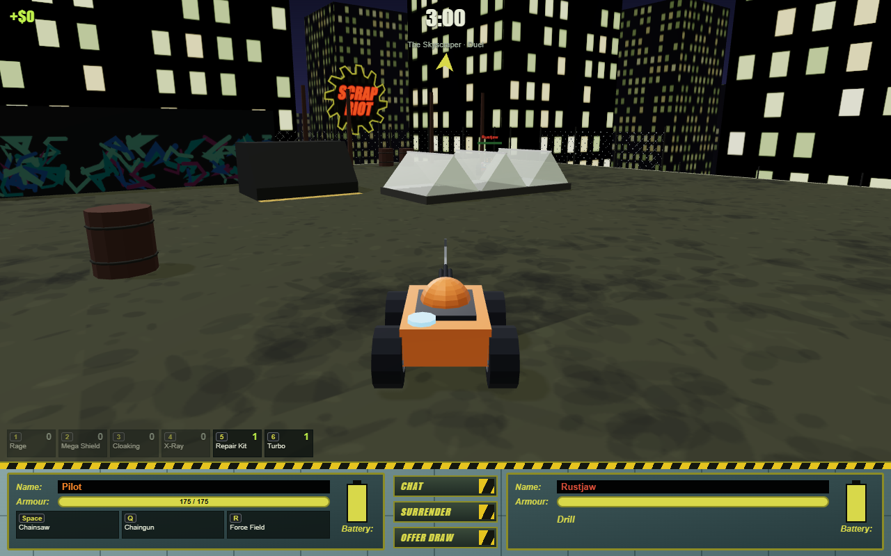
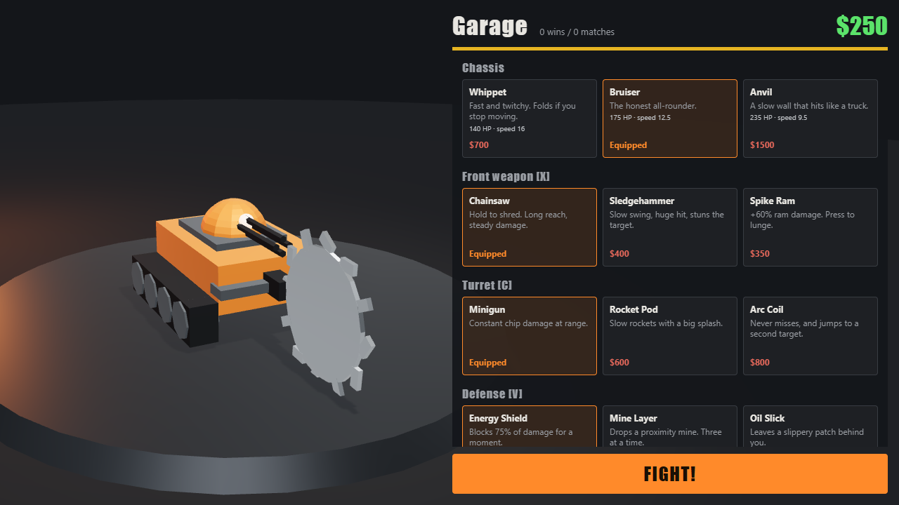

# Scrap Riot

A 3D robot duelling game that runs in the browser. Build a robot in the workshop, meet another pilot on the roof of a skyscraper, and wreck them or knock them over the edge.

Scrap Riot is a fan-made homage to *Robot Rage*, the Miniclip web game. All code, art and sound here are original. The project is not affiliated with or endorsed by Miniclip and uses none of its assets.



## Play

**[Play in your browser](https://nparbs.github.io/scrap-riot/)**. A keyboard and a WebGL-capable browser are required.

To run it locally:

```sh
npm install
npm run dev
```

| Key | Action |
| --- | --- |
| W A S D | Drive |
| Space | Main weapon |
| Q | Turret (aims itself, you choose when to fire) |
| R | Defense |
| 1 to 6 | Rage, Mega Shield, Cloaking, X-Ray, Repair, Turbo |
| E (hold) | Look behind |
| M / Esc | Mute / Pause |

These are the default keys. You can rebind them in Settings, which also lists the gamepad layout.

A duel is one on one with one life each. It ends when a robot is wrecked or falls off the roof, when a pilot surrenders, or when both agree to a draw. If three minutes run out, the most armour left wins. Damage, kills and scrap pickups earn money, and the winner gets a bonus. Progress is saved in the browser's local storage.

## Online play

Press **Lobby** in the workshop to wait for an opponent. A duel starts only once a second pilot joins, and there are no bots online. If your connection drops, a bot drives your robot for 20 seconds while you reconnect, after which you forfeit. Leaving a duel counts as a loss. Chat is a short list of preset phrases.

Play as a guest or sign in with Google to keep your progress across browsers. The Garage page shows your rating and match history, and the Highscore tab shows the leaderboard. See [what is stored](docs/privacy.md).

The server is authoritative: it runs the same simulation as the game, and clients send only their controls. Money, purchases and match results are all decided on the server. To run your own server, see [docs/hosting.md](docs/hosting.md). For local development, run `npm run server:dev` alongside `npm run dev`, which uses an in-memory database.

## What's in the game

- **A workshop** in the style of the original: 5 chassis, plus towers, wheels, engines, power sources and an armour dial. Every part takes up room, and the chassis decides how much there is.
- **37 weapons:** 9 front weapons, 11 turrets and 17 defenses, drawn from every version of the original ([research notes](docs/original-research.md))
- **6 powerups:** Rage, Mega Shield, Cloaking, X-Ray, Repair Kit, Turbo
- **3 upgrade tracks** of 5 levels each: armor, engine, weapons
- **7 maps:** The Skyscraper for duels, plus for Training walled pits, a rooftop and a canyon with lethal drops, a furnace, a piston foundry, and a frozen lake
- **4 modes:** Duel online, plus for Training Free-for-All, Last Robot Standing and King of the Hill
- **Career:** 12 fights with medals and 3 boss robots, plus achievements
- **Customization:** paint colors, patterns, toppers and front or rear weapon mounts, all visible to other players
- **Battle damage:** paint scorches and armor plates fall off as a robot gets hurt
- **AI rivals** that get tougher as you invest in upgrades

See [ROADMAP.md](ROADMAP.md) for what's next.



## Development

```sh
npm test            # simulation and progression tests
npm run typecheck
npm run build       # production build in dist/
npm run balance     # plays 200 AI matches and reports pacing and win rates per item
```

### Layout

| Path | Purpose |
| --- | --- |
| `src/sim/` | The game itself: physics, combat, AI, balance data. No DOM or three.js. |
| `src/game/` | Save data, the shop, rival generation. |
| `src/render/` | three.js scenes and effects. Reads the sim, never writes to it. |
| `src/ui/` | HUD and menu screens (plain DOM). |
| `src/net/` | Protocol and snapshot format shared with the server, plus the browser's network client. |
| `server/` | Authoritative game server: rooms, matchmaking, accounts, REST API. |
| `scripts/balance.ts` | Headless balance report. |

The sim runs at a fixed 60 Hz, uses only its own seeded random number generator, and takes the same input structure from the keyboard and the AI. A seed plus inputs therefore replays a match exactly, which is what online multiplayer will build on.

All balance numbers are in [`src/sim/data.ts`](src/sim/data.ts).

## License

[MIT](LICENSE). The license covers this project's own code and assets only; *Robot Rage* and Miniclip are trademarks of their respective owners.
